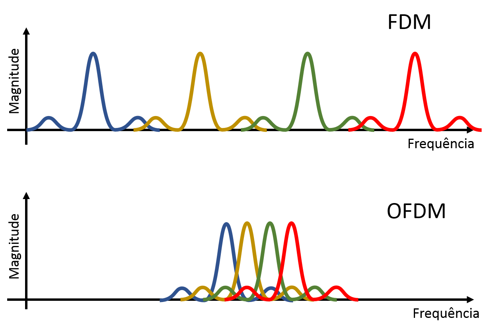

<link rel="stylesheet" href="https://unpkg.com/sakura.css/css/sakura.css" type="text/css">

# Trabalho prático: Elastic Optical Networks 
**Disciplina:** Redes de Computadores II
**Grupo 15:** Carlos Rodrigues, Eduardo Martins e Eduardo Freire

---

## 1. Introdução às Redes Ópticas Elásticas
Redes ópticas elásticas (EONs) são uma evolução recente das redes de fibra óptica, proposta por M. Jinno em 2008, e podem ser caracterizadas como sucessoras da tecnologia DWDM (dense wavelength division multiplexing). Para a compreensão das vantagens das EONs, vamos esclarecer as características da fibra óptica e de suas diferentes versões.

A tecnologia de fibra óptica é pautada em transmitir dados na forma de luz, o que permite taxas de transmissão muito altas e grandes distâncias. Uma fibra óptica é um filamento de espessura comparável à de um fio de cabelo, normalmente construído com sílica, um tipo de vidro. Ela é composta por um núcleo, por uma casca, cujo índice de refração é menor que o do núcleo, e por um revestimento protetor. Com essa configuração, a luz sofre reflexão interna total e permanece no núcleo, assim sendo transmitida pela fibra.

Durante a instalação, que pode ser um processo caro, unem-se várias fibras ópticas em cada cabo. Embora fibra óptica seja um tipo de enlace, muitas redes são projetadas visando ao uso predominante de fibra óptica, e por isso são convenientemente denominadas redes de fibra óptica.

Uma técnica essencial utilizada em enlaces ópticos modernos é a multiplexação por divisão do comprimento de onda (WDM), uma especialização óptica da multiplexação por divisão de frequência (FDM). Ela permite que diferentes canais sejam transmitidos simultaneamente em uma única fibra, cada um em uma faixa de comprimento de onda. Podemos citar 2 categorias de WDM. A multiplexação esparsa (CWDM), em que cada canal ocupa 20nm, transmite até 18 canais entre 1270nm e 1610nm. A multiplexação densa (DWDM) reserva 0,4nm a 0,8nm a cada canal, permitindo a transmissão de mais de 100 canais em uma fibra óptica, acarretando taxa de transmissão total ainda maior.

Transmitir um sinal a uma taxa muito alta em uma pequena faixa de comprimento de onda, como faz o DWDM, implica problemas complexos. A altas taxas, cada símbolo (que representa 1 ou mais bits) tem duração muito pequena. Conforme o sinal viaja, ocorre o fenômeno de dispersão, que pode levar à interferência entre símbolos consecutivos (ISI), e à corrupção dos dados. Para que isso não aconteça, redes DWDM precisam de intervalos de guarda entre símbolos, em que nada é transmitido. Esse fenômeno atua como limitante da taxa de transmissão.

Nesse contexto, são propostas as redes ópticas elásticas, baseadas na tecnologia OFDM (multiplexação por divisão de frequência ortogonal). Enlaces EON são bem menos vulneráveis à dispersão, o que permite taxas de transmissão ainda maiores, o que é essencial frente à demanda imposta por tendências modernas como aplicações de streaming. Além disso, uma fibra óptica EON pode ser dividida entre conexões de forma mais granular e eficiente. No capítulo seguinte, discutiremos como isso é possível.

## 2. Arquiteturas e Tecnologias
Primeiramente, vamos esclarecer do que se trata a OFDM. Em um enlace FDM tradicional, as faixas de frequência que estão transmitindo não podem se sobrepor. A OFDM, porém, divide cada canal em subportadoras cujas faixas de frequência admitem certa sobreposição, desde que a sobreposição seja ortogonal. Nessas condições, o pico de uma subportadora coincide com o cruzamento de zero de outra, e é possível a recuperação dos sinais originais. Esse arranjo permite a transmissão de várias subportadoras em uma pequena faixa de frequência, característica que denominamos eficiência espectral.

Além disso, em um enlace OFDM, cada subportadora transmite a uma taxa pequena. Como resultado, os símbolos são transmitidos com duração maior, e tornam-se bem menos vulneráveis à dispersão e à interferência entre símbolos. Por isso, os intervalos de guarda podem ser menores. Além disso, a grande quantidade de subportadoras em paralelo implica que a taxa de transmissão total por canal é substancialmente maior do que seria em um enlace FDM.

Além de poder transmitir a uma taxa maior, uma EON é, em vários aspectos, mais flexível do que uma rede DWDM tradicional. Em um enlace DWDM, cada canal tem uma faixa de comprimento de onda fixa (digamos, de 0.4nm), que possibilita certa taxa de transmissão. Contudo, frequentemente, é necessário alocar um canal a uma conexão que não demanda essa quantidade de recursos, o que implica desperdício. Em um enlace OFDM, contudo, cada canal pode receber apenas a quantidade de subportadoras necessárias para suprir a demanda da conexão.

Outra funcionalidade de enlaces OFDM é a modulação adaptativa (AMC). Cada canal pode ser seguir um algoritmo de modulação diferente, dependendo das condições de transmissão. Por exemplo, um canal com caminho óptico curto pode usar QAM (modulação de amplitude em quadratura) com 16 símbolos diferentes e 4 bits por símbolo. Ao mesmo tempo, um canal com caminho óptico mais comprido pode usar QPSK (chaveamento por deslocamento de fase em quadratura), que carrega apenas 2 bits por símbolo, mas é mais resistente a corrupção de dados.

Essas funcionalidades são suportadas pelo transponder de largura de banda variável (BVT). Em geral no contexto de fibra óptica, um transponder é um dispositivo que recebe um sinal óptico em uma faixa de comprimento de onda e retransmite em outra. Visando à flexibilidade das EONs, um BVT é capaz de ajustar seu comportamente em função da taxa de dados que precisa ser transmitida de forma eficiente. Esse objetivo é atingido por meio do controle do número de subportadoras necessário e da modulação adaptativa, mencionados acima.

## 3. O problema de Roteamento e Alocação de Espectro

## 4. Controle, Design e Gerenciamento da Rede

## 5. Tópicos Avançados e Tendências

## 6. Conclusões

---

## 7. Referências
